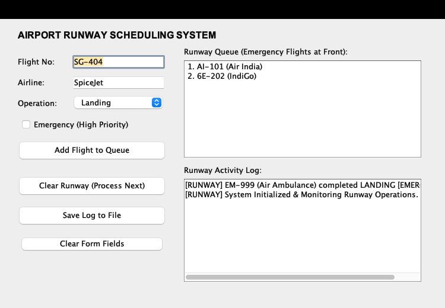

# ✈️ Airport Runway Scheduling System

A Java and Data Structures project modeling a single-runway airport traffic controller. Built using pure **Object-Oriented Programming (OOP)**, custom **Linked-List Priority Queues** (no built-in Java collections), and a classic **Java Swing GUI**.



---

## 📌 Project Overview
Managing flight traffic on a single runway requires strict prioritization to prevent collisions and resolve in-flight emergencies. This application schedules both landing and takeoff operations through an automated queue system where:
* **Routine Flights:** Handled under a strict **First-In-First-Out (FIFO)** policy.
* **Emergency Flights (Low Fuel / Medical):** Automatically **preempt** waiting aircraft and jump directly to the front of the queue ($O(1)$ priority insertion).
* **Data Persistence:** Every flight clearance is permanently logged into `runway_log.txt`.

---

## 🛠️ Data Structures & Complexity

Rather than relying on `java.util.PriorityQueue`, this project implements a custom **Singly Linked List** from first principles to demonstrate fundamental data structure concepts:

```
[ FRONT / HEAD ]                                                      [ REAR / TAIL ]
       │                                                                     │
       ▼                                                                     ▼
┌──────────────┐     ┌──────────────┐     ┌──────────────┐            ┌──────────────┐
│ [EMERGENCY]  │ ──> │ Routine A    │ ──> │ Routine B    │ ── ... ──> │ Routine N    │ ──> null
│ EM-999       │     │ AI-101       │     │ 6E-202       │            │ SG-404       │
└──────────────┘     └──────────────┘     └──────────────┘            └──────────────┘
  (Jumped Here)
```

| Operation | Method | Time Complexity | Description |
| :--- | :--- | :---: | :--- |
| **Normal Enqueue** | `enqueue(Aircraft a)` | **$O(1)$** | Appended at `rear` (Tail) |
| **Emergency Enqueue** | `enqueue(Aircraft a)` | **$O(1)$** | Preempts line, inserted at `front` (Head) |
| **Runway Dequeue** | `dequeue()` | **$O(1)$** | Removed from `front` (Head) |
| **Display Traversal**| `getDisplayList()` | **$O(n)$** | Traverses nodes to format text area |

---

## 👥 Team Work Distribution

| Member | Module / File | Responsibility |
| :--- | :--- | :--- |
| **Justin Joe Mathew** | [`Aircraft.java`](Aircraft.java) | **OOP Modeling:** Aircraft data encapsulation (`flightNo`, `airline`, `type`, `isEmergency`), constructor, and custom `toString()`. |
| **Elna Elizabeth Abraham** | [`Node.java`](Node.java)<br>[`FlightQueue.java`](FlightQueue.java) | **Core Data Structures:** Custom Singly Linked List Queue implementation, pointer manipulation, and priority preemption logic. |
| **K Sruthika** | [`RunwayUI.java`](RunwayUI.java) | **UI & System Integration:** Java Swing GUI (`JFrame`, `setBounds`, `ActionListener`), component layout, and runtime event management. |
| **Devika Suresh** | [`FileHandler.java`](FileHandler.java)<br>[`TestRunway.java`](TestRunway.java) | **File Persistence & Testing:** Permanent logging via `FileWriter`, edge-case testing (queue underflow), and headless verification. |

---

## 🚀 Getting Started

### Prerequisites
* Java Development Kit (JDK 17 or higher)

### 1. Clone the Repository
```bash
git clone https://github.com/jvstin47/airport-runway-scheduler.git
cd airport-runway-scheduler
```

### 2. Run the Application
You can launch the GUI using the provided helper script:
```bash
./run.sh
```

Or compile and execute manually:
```bash
# Compile all Java source files
javac *.java

# Launch the Swing GUI
java RunwayUI
```

### 3. Run Automated Tests (Headless)
To verify queue operations, priority preemption, and file logging without the GUI:
```bash
java TestRunway
```

---

## 📖 Viva Voce Reference
For comprehensive questions and answers tailored to each team member's role for the oral examination, see [`VIVA_GUIDE.md`](VIVA_GUIDE.md).

---

## 📄 License
This project is open-source and created for educational purposes.
